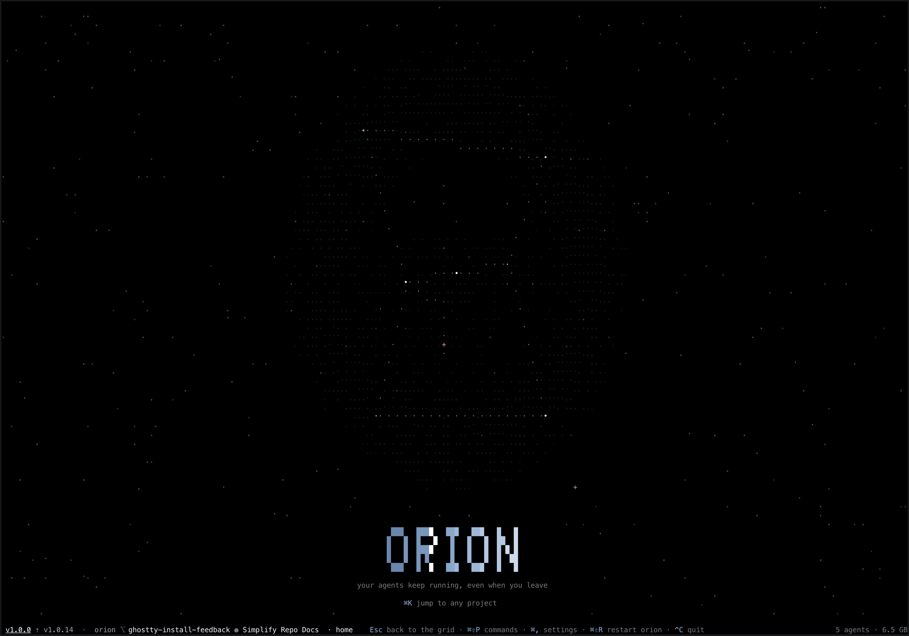

<div align="center">

# orion

**Mission control for your coding agents.**

Run Claude Code, Codex, Cursor, Pi, Muse, Grok and OpenCode across every project and worktree, from one grid. They keep working when you close it.

macOS · Linux



</div>

> [!NOTE]
> Built for my own workflow and my colleagues'. Keys and features move. Fork it if you want something stable.

## Install

```sh
curl -fsSL https://raw.githubusercontent.com/oliverkidd/orion/main/install.sh | sh
```

That is the whole install. It needs git. On a Mac it also gets Ghostty if you don't have it, then opens orion as its own app, **Orion.app**.

## Run

- **Mac:** open **Orion** from the Dock or Spotlight. Typing `orion` in a terminal opens the same app.
- **Linux, ssh, tmux:** run `orion` in a terminal.

The first launch walks you through setup, including installing an agent if you have none. `orion upgrade` gets the latest release.

## Core features

- **One grid for every agent.** Each project and git worktree gets a band; each agent is a card showing what it is doing and whether it needs you.
- **Agents keep running.** A background daemon owns every session, so you can close orion and come back to the same agents and their scrollback.
- **A worktree per task.** Start an agent on a fresh worktree in one step, so parallel tasks never share a checkout.
- **Review without leaving.** Read the diff, find a file, search the code and open an editor on any checkout.
- **Pull requests and Linear.** See each checkout's pull request and checks, and start an agent straight from a Linear issue.
- **It tells you when to look.** A sound and a notification when an agent finishes, crashes or needs an answer.

| Key | Does |
|---|---|
| `⌘N` | New agent: type the task, `Enter` |
| `↑` `↓` · `Enter` · `Esc` | Walk the grid · step into a session · back out |
| `⌘K` | Jump to any project, worktree or session |
| `⌘E` · `⌘P` · `⌘⇧F` | Diff · find file · search |
| `⌘L` | Linear issues |
| `⌘,` | Settings |

In a terminal use `Ctrl` in place of `⌘`. Every key: [docs/keys.md](docs/keys.md).

## Docs

[Keys](docs/keys.md) · [Commands](docs/commands.md) · [Sessions](docs/sessions.md) · [Configuration](docs/configuration.md) · [How it works](docs/how-it-works.md) · [Architecture](ARCHITECTURE.md)

## License

MIT. A customized fork of [nebula](https://github.com/AgentSystemLabs/nebula) by [Cody Seibert](https://github.com/codyseibert).
